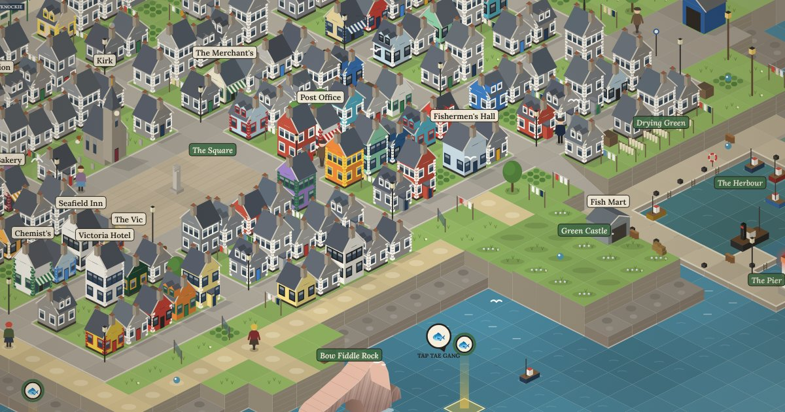

# Portknockie: Muckle Helpin Haun

A cosy isometric village game set in **Portknockie** on the Moray Coast in the 1950s. Take a job, work your way round the fisher cottages, harbour and braes, and earn your wages. You can play in Doric or English.

## Play

Open `index.html` in any modern browser. It works on phones, tablets and desktops. There is nothing to install or build.

- **Tap or click** the map to walk or drive there. Tap again to stack more stops on your route.
- On a computer you can also use **WASD** or the **arrow keys**.
- Tap the edge arrow to head straight for an off-screen job.

## Jobs

There are twelve jobs, and you unlock more as your lifetime wages grow:

Paper Round · Postie · Scaffie · Scaffie's Cairt · Fisher Quine · Milk Round · Village Bobby · Fisherman · Fish Courier · Lamplighter · Taxi Driver · Bluebird Bus

## Features

- Landmarks from the real village: Bow Fiddle Rock, Jenny's Well, Green Castle, the harbour and pier, the Victoria Hotel, the Vic, the Seafield Inn, Cruats Farm and the railway viaduct.
- Seasons, weather, time of day and a day/night light cycle.
- Six original tunes in a Scottish folk style, plus sound effects.
- Ranks, stars, daily orders, streaks, postcards and achievements, and a Village Fund that improves the village.
- Doric is the default language, with a one-tap switch to English.
- Lots of settings for gameplay, display, accessibility and audio.

Progress is saved in the browser's local storage on the device you play on.

## Hosting on GitHub Pages

1. Push these files to the root of a repository.
2. Go to **Settings → Pages**, set the source to **Deploy from a branch**, and choose `main` / `/ (root)`.
3. The game will be live at `https://<your-user>.github.io/<repo>/`.

## Files

| File | Purpose |
|---|---|
| `index.html` | The whole game (HTML, CSS and JavaScript in one file) |
| `manifest.webmanifest`, `icon-*.png` | Lets players add the game to their home screen |
| `preview.jpg` | Image shown when the link is shared |
| `.nojekyll` | Tells GitHub Pages to serve the files as they are |
| `LICENSE` | Terms of use |

## Credits

Developed by **Croftware**, Nathan Brown. Contact: [nathan@croftware.com](mailto:nathan@croftware.com)

© 2026 Croftware. All rights reserved.

## Licence

Free to play for personal, non-commercial use. Copying, modifying, redistributing or commercial use is not permitted without written permission. See [LICENSE](LICENSE) for details.
